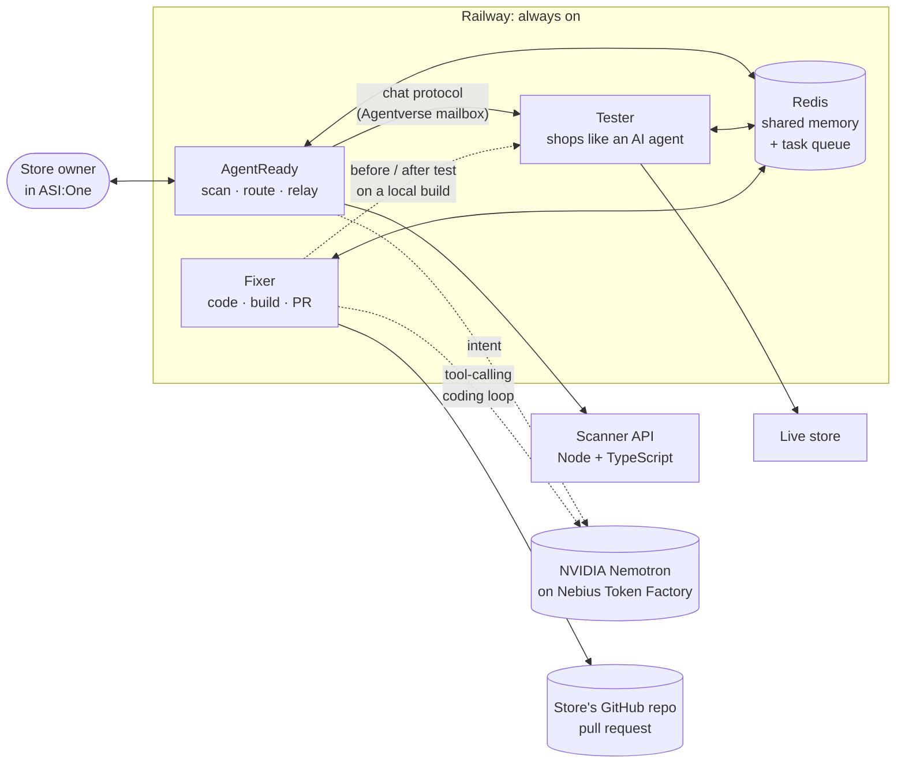

<div align="center">


# AgentReady

**Make any online store shoppable by AI agents: scan it, test it like a real AI shopper, fix the code, prove it.**


Submitted to the **Nebius × NVIDIA Global AI Hackathon** · Best Apps and Agents track<br>
The agents think with **NVIDIA Nemotron on Nebius Token Factory**

[](https://agentverse.ai/agents/details/agent1qwl5c4d77prydcy4skseaktuwquy6qwdp68fv5fqrkdgfvx3ph9uc6w8a2v/profile)
[](https://ds-tau-liard.vercel.app)

[Chat with AgentReady](https://agentverse.ai/agents/details/agent1qwl5c4d77prydcy4skseaktuwquy6qwdp68fv5fqrkdgfvx3ph9uc6w8a2v/profile) ·
[Web app](https://agentready-five-rust.vercel.app) ·
[Demo](#demo) ·
[How it works](#how-it-works) ·
[Results](#results) ·
[Run it](#run-it-locally)

</div>

---


> **Current security mode:** public scanning and restricted cart tests are supported.
> Fixer access requires an operator-verified requester/repository/site binding.
> Agent-driven merges are disabled; review and merge in GitHub. Repository
> execution remains disabled by default. This repository does not yet provide the
> isolated runner and per-job local testing capability needed to reproduce the
> historical end-to-end Fixer demo securely. See [SECURITY-REVIEW.md](SECURITY-REVIEW.md).

## Demo

| | |
|---|---|
| 🛒 **Test store** | **[ds-tau-liard.vercel.app](https://ds-tau-liard.vercel.app)**: Dhaga Studio, a multi-page handloom store ([code](https://github.com/shubhtanna/dhaga-studio-store)) built the way real stores usually are: prices and the bag only work in the browser. The Tester scores it **1/5**. |
| 🎬 **Earlier walkthrough** | [Full flow (9 min)](https://drive.google.com/file/d/1zL5EpB6Fkmsgs4uQJxce62DRJo8xgLJ9/view?usp=sharing), recorded before the move to Nemotron and the security hardening: the three agents, a live fix on [Kaapi Collective](https://kaapi-collective.vercel.app) and the merged [pull request](https://github.com/shubhtanna/kaapi-collective-store/pull/1) (**0/5 → 5/5**) |
| 💬 **Try it yourself** | Open [AgentReady on Agentverse](https://agentverse.ai/agents/details/agent1qwl5c4d77prydcy4skseaktuwquy6qwdp68fv5fqrkdgfvx3ph9uc6w8a2v/profile), click **Chat with Agent**, and send a store address |

## The problem

AI assistants such as ChatGPT, Gemini and Perplexity are starting to shop for people: they find products, compare them, fill a cart and hand over a checkout link. Most online stores were built only for human eyes and clicks, so these agents get stuck:

| What a shopping agent needs to do | What usually goes wrong |
|---|---|
| Read the products | The page is empty until JavaScript runs, and most agents don't run it |
| Understand name and price | No machine-readable product data (JSON-LD, sitemap, `llms.txt`) |
| Add to cart | The cart only works through button clicks, or `robots.txt` blocks agents from it |
| Hand over a checkout | The cart lives in the agent's session, so the link opens an empty cart for the human |

The agent quietly gives up, and the store never learns it lost a sale.

## The solution

Three Fetch.ai agents, registered on Agentverse and usable from ASI:One, that work as one team:

| | Agent | What it does | Agentverse |
|---|---|---|---|
|  | **AgentReady**<br>`@agentready` | Scans a store and grades how well AI agents can find, read and buy from it, then coordinates the other two agents | [Profile](https://agentverse.ai/agents/details/agent1qwl5c4d77prydcy4skseaktuwquy6qwdp68fv5fqrkdgfvx3ph9uc6w8a2v/profile) |
|  | **AgentReady Tester**<br>`@agentready-tester` | Shops on the store exactly like an AI agent (find, compare, add to cart, checkout link) and reports each step as pass or fail | [Profile](https://agentverse.ai/agents/details/agent1qvxkjpe6z7gnheuzqhf6hp6cuwld7serzjuhktyvdph9cgn3vgf6zw3zv2e/profile) |
|  | **AgentReady Fixer**<br>`@agentready-fixer` | Changes the store's code on GitHub, proves the change with a before/after shopping test, and opens a pull request | [Profile](https://agentverse.ai/agents/details/agent1q2y3q9z0y3dd3rj4m5ajgu5vpkv6gwaff2h2jd52yhx3l6demp0lxnaq9sd/profile) |

<details>
<summary>Agent addresses</summary>

| Agent | Address |
|---|---|
| AgentReady | `agent1qwl5c4d77prydcy4skseaktuwquy6qwdp68fv5fqrkdgfvx3ph9uc6w8a2v` |
| AgentReady Tester | `agent1qvxkjpe6z7gnheuzqhf6hp6cuwld7serzjuhktyvdph9cgn3vgf6zw3zv2e` |
| AgentReady Fixer | `agent1q2y3q9z0y3dd3rj4m5ajgu5vpkv6gwaff2h2jd52yhx3l6demp0lxnaq9sd` |

</details>

## One conversation, three agents

Everything happens in a single ASI:One chat with AgentReady. The owner never has to talk to the other agents. This is the run shown in the [demo video](https://drive.google.com/file/d/1zL5EpB6Fkmsgs4uQJxce62DRJo8xgLJ9/view?usp=sharing) (replies shortened):

```text
You:        Make kaapi-collective.vercel.app agent ready and score it.
AgentReady: Part 1: AI readiness scan: grade F (0/100).
            Part 2: Can an AI agent actually buy here? 0 / 5 steps.
            ❌ products unreadable  ❌ nothing to compare  ❌ no cart  ❌ no checkout link
            Want it fixed? Reply "fix it" with your store's GitHub repo.
You:        fix it, github.com/shubhtanna/kaapi-collective-store
AgentReady: Handed to the Fixer. I'll pass its updates on to you here.
            ⏳ Fixer: plan ready, 4 fixes for a Next.js 16 (App Router) store…
            ⏳ Fixer: installing · testing the original · changing the code · checking…
            ✅ Pull request ready: AI shopping test 0/5 → 5/5. Review it on GitHub.
You:        (merges the pull request on GitHub)  →  retest
AgentReady: Result: 5 / 5 steps. ✅ An AI agent can shop here.
            🛒 Ready to buy: Steel South Indian Filter · ₹399 is already in your cart.
            👉 Go to checkout: kaapi-collective.vercel.app/checkout?items=KC-G01:1
```

From "fix it" to an opened pull request took about **3½ minutes**. The checkout link opens on the shopper's own device with the product already in the cart: they only enter delivery details and pay.

## How it works



- **Agent Chat Protocol on Agentverse.** All three agents are [uAgents](https://github.com/fetchai/uAgents) that publish the chat protocol manifest and connect through Agentverse mailboxes, so ASI:One can discover and talk to them.
- **NVIDIA Nemotron on Nebius Token Factory for reasoning.** A fast Nemotron model reads intent from chat messages; a larger Nemotron drives the Fixer's tool-calling coding loop. See [Nemotron on Nebius](#nemotron-on-nebius-token-factory).
- **Shared memory.** Whatever you tell one agent (site, repo, shopping task, scan, test result, fix status), the others know. Say `status` to any of them.
- **Hand-offs.** Agents post tasks to each other through a Redis queue. The Fixer's progress (install, test, code, check, pull request) is relayed live through the agent you are chatting with, and the chat session stays open until the final result, so it all stays in one conversation.
- **Ready to buy.** When an agent can complete the purchase, the reply starts with the chosen product, its price and a checkout link with the product already in the cart. If the store needs something first (for example a minimum order value), it says so.
- **Safe by design.** The Fixer only touches repos on an allow-list, edits code through a small set of safe tools (it cannot run arbitrary commands or touch secrets, lockfiles or git), and never merges without your approval. A change that doesn't improve the shopping test is opened as a clearly labelled **draft** pull request instead, and debugging leftovers never end up in a commit.
- **Ignores chatter.** ASI:One's assistant comments on agent messages; long commentary is never treated as a request, and commands like "fix it" or "merge" only count in short messages, so the agents can't loop or act on text you didn't send.
- **Honest testing.** The Tester reads plain HTML without JavaScript, keeps cookies only for its own session, honours `robots.txt`, and must hand back a checkout link that works on a different device with no agent cookies.

### The Tester's five steps

| Step | Passes when |
|---|---|
| 1. Reach the site | The homepage has readable content without JavaScript |
| 2. Find products | Matching products can be read from links, sitemap, `llms.txt` or structured data |
| 3. Compare options | At least two matches have a readable name and price |
| 4. Add to cart | The product lands in a cart through something the site exposes, and `robots.txt` allows it |
| 5. Checkout link | The link, opened by the human with no agent cookies, shows a checkout with the chosen product |

### What the Fixer changes

It maps failed steps to generic fixes (nothing store-specific) and implements them in the store's own stack: **Next.js, Vite (React/Vue/Svelte), Node/Express, Flask, Django or plain HTML**, including stores in a sub-folder of a monorepo (`frontend/`, `web/`, `apps/*`). When an operator turns on isolated execution (`FIXER_ISOLATED_EXECUTION=1`, only inside a disposable sandbox), it also installs and builds the store locally, tests the original and the patched copy, and stops if the local copy doesn't behave like the live site. By default this is off: running a stranger's repository means running their code. See [SECURITY-NOTES.md](SECURITY-NOTES.md).

- Let AI shopping agents in through `robots.txt`
- Make products readable without JavaScript (build-time or server-rendered pages)
- Publish product data for agents: JSON-LD, sitemap and `llms.txt`
- A plain-HTML add-to-cart that works without scripts
- A checkout link that carries the cart, so it works on the shopper's own device

## Results

Demo stores on common stacks, each built the way real stores usually are, not broken on purpose. Same Tester, same task, before and after the Fixer's pull request. These runs were recorded with local before/after testing switched on, before the security hardening made it opt-in.

| Store | Stack | Before | After | Pull request |
|---|---|:-:|:-:|---|
| [**Kaapi Collective**](https://kaapi-collective.vercel.app) (live in the [demo video](https://drive.google.com/file/d/1zL5EpB6Fkmsgs4uQJxce62DRJo8xgLJ9/view?usp=sharing)) | Next.js 16 (App Router) | 0/5 | **5/5** | [kaapi-collective-store#1](https://github.com/shubhtanna/kaapi-collective-store/pull/1) |
| [Stride Lab](https://stride-lab-beta.vercel.app) | React SPA (Vite) | 0/5 | **5/5** | [stride-lab-store#2](https://github.com/shubhtanna/stride-lab-store/pull/2) |
| [Nest & Grain](https://nest-and-grain.vercel.app) | Next.js | 4/5 | **5/5** | [nest-and-grain-store#1](https://github.com/shubhtanna/nest-and-grain-store/pull/1) |
| [Masala Mandi](https://masala-mandi.onrender.com) | Flask | 4/5 | **5/5** | [masala-mandi-store#1](https://github.com/shubhtanna/masala-mandi-store/pull/1) |
| [Tara Handmade](https://tara-handmade.vercel.app) | Plain HTML/JS | 1/5 | **5/5** | [tara-handmade-store#2](https://github.com/shubhtanna/tara-handmade-store/pull/2) |
| [VoltKart](https://voltkart.onrender.com) | Node + Express | 3/5 | **5/5** | [voltkart-store#1](https://github.com/shubhtanna/voltkart-store/pull/1) |

After the pull requests were merged, the Tester scored **5/5 on every live store**. Kaapi Collective was fixed end to end from a single ASI:One chat, as shown in the demo video. The checkout links it handed over were then used to place demo orders as a human would (Nest & Grain `NG-MVJ6W8DN`, Masala Mandi `MM2652303`, Tara Handmade `TH342453`, Stride Lab `SL52386880`). Raw reports are in [`agents/results/`](agents/results).

## Nemotron on Nebius Token Factory

Every model call the agents make goes to **NVIDIA Nemotron** through the **Nebius Token Factory** inference API (OpenAI-compatible, `https://api.tokenfactory.nebius.com/v1/`). The choice of provider and model lives in one file, [`agents/shared/llm.py`](agents/shared/llm.py).

| Where | Model (default, set in `.env`) | Why this size |
|---|---|---|
| **AgentReady**: read what the owner wants from a chat message (scan which site, what to shop for) | `NEBIUS_CHAT_MODEL` = Nemotron Nano | Runs on every message, so it must be fast and cheap. Sent with `/no_think`: routing needs no long reasoning. |
| **Fixer**: the tool-calling loop that reads the store's code, edits it, builds it and runs the shopping test until it passes | `NEBIUS_CODER_MODEL` = Nemotron Super | Multi-step reasoning over a real codebase with up to 60 tool calls per fix. |

How Token Factory helps the workflow:

- **One OpenAI-compatible endpoint** for both models, so swapping the model is one environment variable and no code change.
- **Right-sized models per job**: the Nano handles the high-volume chat routing, the Super handles the rare but heavy code changes, so the chat stays responsive and credits last longer.
- **Streaming with tool calls** keeps long file writes from timing out during a fix.

Check your key and see the exact model ids your account can use:

```bash
cd agents
python tools/list_models.py --ping
```

If `NEBIUS_API_KEY` is empty, the agents fall back to ASI:One (`ASI1_API_KEY`), and with no key at all AgentReady still understands store addresses with simple rules.

### What changed during the Nebius × NVIDIA hackathon

AgentReady's first version ran on ASI:One's model. During this hackathon we made three major updates:

1. **NVIDIA Nemotron on Nebius Token Factory.** All agent reasoning moved to Nemotron: a small model for chat routing and a large model for the coding loop, behind one provider layer ([`agents/shared/llm.py`](agents/shared/llm.py)), with handling for Nemotron's reasoning output and a model-check tool.
2. **SSRF protection.** The scanner and the Tester only reach public websites: every DNS answer is validated and pinned, and private networks, DNS rebinding, unsafe redirects, non-standard ports and proxies are blocked. The Fixer's file tools refuse credentials and path traversal, and repository execution is off by default. See [SECURITY-NOTES.md](SECURITY-NOTES.md).
3. **Privacy and access control.** Personal data is redacted before it reaches Nemotron, logs or reports; chat memory expires after 24 hours; the Tester never fills in customer details or submits a checkout. Only operator-enrolled requester/repo/site bindings can use the Fixer, agents can't merge pull requests, and rate limits and CORS are stricter. See [PRIVACY.md](PRIVACY.md) and [SECURITY-REVIEW.md](SECURITY-REVIEW.md).

We also added an MIT license, regression tests and a new test store, [Dhaga Studio](https://ds-tau-liard.vercel.app).

## Repository layout

| Folder | What it is |
|---|---|
| [`agents/`](agents) | The three Fetch.ai uAgents (Python), shared memory and hand-offs, Dockerfile. See [`agents/README.md`](agents/README.md). |
| [`agents/agentready_agent/`](agents/agentready_agent) | AgentReady: chat wiring, intent understanding (Nemotron), scan, routing to the Tester and Fixer |
| [`agents/tester_agent/`](agents/tester_agent) | Tester: the five shopping steps and a plain-HTTP "browser" |
| [`agents/fixer_agent/`](agents/fixer_agent) | Fixer: stack detection, fix playbook, Nemotron coding loop, local build and test, GitHub PRs |
| [`agents/shared/`](agents/shared) | Shared memory, task queue and team hand-offs (Redis); `llm.py` picks the Nemotron models on Nebius |
| [`agentready-api/`](agentready-api) | Scanner API: Node, TypeScript, Express, MongoDB. Seven checks, 0–100 score and grade, ready-to-paste fixes. See [`ARCHITECTURE.md`](agentready-api/ARCHITECTURE.md). |
| [`web/`](web) | Web app: React, Vite, Tailwind. Scan page and report UI. |

## Tech stack

**Agents:** Python 3.11, Fetch.ai uAgents 0.25, Agent Chat Protocol, Agentverse mailbox, NVIDIA Nemotron on Nebius Token Factory (OpenAI-compatible API), Redis, httpx, BeautifulSoup<br>
**Scanner API:** Node.js, TypeScript, Express, MongoDB<br>
**Web app:** React 18, Vite, Tailwind CSS<br>
**Hosting:** Railway (agents + Redis), Render (API), Vercel (web app and demo stores)

## Run it locally

### Agents

Requires Python 3.10+ (and Node 20 + git for the Fixer).

```bash
cd agents
python -m venv .venv
source .venv/bin/activate        # Windows: .venv\Scripts\activate
pip install -r requirements.txt
cp .env.example .env             # then fill it in
```

In `.env`, set a long secret phrase for each `*_AGENT_SEED` and your [Nebius Token Factory API key](https://tokenfactory.nebius.com) as `NEBIUS_API_KEY`. Run `python tools/list_models.py` to check it. Without `REDIS_URL`, memory stays inside one process, which is enough to try the agents locally.

```bash
python tools/local_chat_test.py "Is example.com ready for AI shoppers?"     # agent + test client, no Agentverse needed
python tools/run_tester.py https://example-store.com "running shoes under ₹10,000"
python tools/run_fixer.py mystore.com github.com/you/your-store "earbuds" --apply all --dry   # fix and test, no PR
```

To connect to Agentverse and ASI:One, set `AGENT_MAILBOX=true`, run an agent, open the inspector link it prints and click **Connect → Mailbox**.

### Scanner API and web app

Requires Node 18+.

```bash
npm install
npm run install:all
npm run dev          # API on :5100 with an in-memory MongoDB, web app on :5173
```

## Deployment

| Piece | Where | How |
|---|---|---|
| Three agents | Railway, one service each | One Docker image ([`agents/Dockerfile`](agents/Dockerfile)); `AGENT_SCRIPT` picks the agent; mailbox mode connects them to Agentverse |
| Shared memory | Railway Redis | `REDIS_URL` on each agent service |
| Scanner API | Render | [`render.yaml`](render.yaml) |
| Web app | Vercel | `web/` |

Key settings (see [`agents/.env.example`](agents/.env.example)): `NEBIUS_API_KEY`, `NEBIUS_CHAT_MODEL` and `NEBIUS_CODER_MODEL` (Nemotron on Token Factory), `FIXER_ALLOWED_REPOS` and `FIXER_REQUESTER_BINDINGS` (who may ask the Fixer to change which repo), `GITHUB_TOKEN` (contents and pull requests: read and write), `TEAM_AUTO_FIX`.

## Limitations and what's next

- **Stacks:** Nuxt, Astro, SvelteKit, WordPress and Shopify stores can be scanned and tested today, but the Fixer can't change them yet.
- **Repo access:** the Fixer works on repos on its allow-list that its GitHub token can push to. A GitHub App install per store owner is the next step, so owners can connect their own repo in one click.
- **Sandboxed execution:** a disposable, isolated runner so the Fixer's before/after test can be switched back on safely (see [SECURITY-REVIEW.md](SECURITY-REVIEW.md)).
- **Stores that need production secrets** (an external database, API keys) can't be reproduced locally, so the Fixer stops rather than guessing.
- **Next:** the same scan → fix → pull request flow for AI-readiness (visibility to ChatGPT, Gemini and other AI assistants), not only agent checkout.

## License

[MIT](LICENSE)

## Team

| | |
|---|---|
| **Shubh Tanna** | [@shubhtanna](https://github.com/shubhtanna) |
| **Nisarg Jolapara** | [@Nisarg004](https://github.com/Nisarg004) |
| **Bharat Gupta** | |
| **Manaswi Mittal** | |

