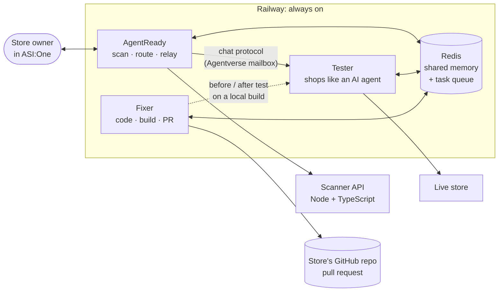

<div align="center">


# AgentReady

**Make any online store shoppable by AI agents: scan it, test it like a real AI shopper, fix the code, prove it.**


Built at **Fetch-A-Thon 3.0** · Masters' Union × Fetch.ai × Innovation Lab × GeeksforGeeks

[Chat with AgentReady](https://agentverse.ai/agents/details/agent1qwl5c4d77prydcy4skseaktuwquy6qwdp68fv5fqrkdgfvx3ph9uc6w8a2v/profile) ·
[Web app](https://agentready-five-rust.vercel.app) ·
[How it works](#how-it-works) ·
[Results](#results) ·
[Run it](#run-it-locally)

</div>

---

## The problem

AI assistants such as ChatGPT, Gemini and Perplexity are starting to shop for people: they find products, compare them, fill a cart and hand over a checkout link. Most online stores were built only for human eyes and clicks, so these agents get stuck:

| What a shopping agent needs to do | What usually goes wrong |
|---|---|
| Read the products | The page is empty until JavaScript runs, and most agents don't run it |
| Understand name and price | No machine-readable product data (JSON-LD, sitemap, `llms.txt`) |
| Add to cart | The cart only works through button clicks, or `robots.txt` blocks agents from it |
| Hand over a checkout | The cart lives in the agent's session, so the link opens an empty cart for the human |

The agent quietly gives up, and the store never learns it lost a sale.

## The solution

Three Fetch.ai agents, registered on Agentverse and usable from ASI:One, that work as one team:

| | Agent | What it does | Agentverse |
|---|---|---|---|
|  | **AgentReady**<br>`@agentready` | Scans a store and grades how well AI agents can find, read and buy from it, then coordinates the other two agents | [Profile](https://agentverse.ai/agents/details/agent1qwl5c4d77prydcy4skseaktuwquy6qwdp68fv5fqrkdgfvx3ph9uc6w8a2v/profile) |
|  | **AgentReady Tester**<br>`@agentready-tester` | Shops on the store exactly like an AI agent (find, compare, add to cart, checkout link) and reports each step as pass or fail | [Profile](https://agentverse.ai/agents/details/agent1qvxkjpe6z7gnheuzqhf6hp6cuwld7serzjuhktyvdph9cgn3vgf6zw3zv2e/profile) |
|  | **AgentReady Fixer**<br>`@agentready-fixer` | Changes the store's code on GitHub, proves the change with a before/after shopping test, and opens a pull request | [Profile](https://agentverse.ai/agents/details/agent1q2y3q9z0y3dd3rj4m5ajgu5vpkv6gwaff2h2jd52yhx3l6demp0lxnaq9sd/profile) |

<details>
<summary>Agent addresses</summary>

| Agent | Address |
|---|---|
| AgentReady | `agent1qwl5c4d77prydcy4skseaktuwquy6qwdp68fv5fqrkdgfvx3ph9uc6w8a2v` |
| AgentReady Tester | `agent1qvxkjpe6z7gnheuzqhf6hp6cuwld7serzjuhktyvdph9cgn3vgf6zw3zv2e` |
| AgentReady Fixer | `agent1q2y3q9z0y3dd3rj4m5ajgu5vpkv6gwaff2h2jd52yhx3l6demp0lxnaq9sd` |

</details>

## One conversation, three agents

Everything happens in a single ASI:One chat with AgentReady. The owner never has to talk to the other agents.

```text
You:        Is voltkart.onrender.com ready for AI shoppers?
AgentReady: Grade C, 61/100. Our Tester tried to shop: 3/5 steps.
            ❌ robots.txt blocks AI agents from /cart. Want it fixed? Reply "fix it".
You:        fix it, code at github.com/you/voltkart-store
AgentReady: Handed to the Fixer.
            Fixer: reading the code and testing the site…
            Fixer: plan ready, 2 fixes for a Node/Express store. Applying and testing…
            ✅ Pull request ready: AI shopping test 3/5 → 5/5. Reply "merge".
You:        merge
AgentReady: Merged. Waiting for the redeploy…
            ✅ voltkart.onrender.com is fixed and live. The Tester shopped on it: 5/5.
```

## How it works



- **Agent Chat Protocol on Agentverse.** All three agents are [uAgents](https://github.com/fetchai/uAgents) that publish the chat protocol manifest and connect through Agentverse mailboxes, so ASI:One can discover and talk to them.
- **ASI:One's own model (`asi1`) for reasoning.** It reads intent from chat messages, and drives the Fixer's tool-calling coding loop.
- **Shared memory.** Whatever you tell one agent (site, repo, shopping task, scan, test result, fix status), the others know. Say `status` to any of them.
- **Hand-offs.** Agents post tasks to each other through a Redis queue. The Fixer's progress is relayed back through the agent you are chatting with, so it all stays in one conversation.
- **Safe by design.** The Fixer only touches repos on an allow-list, edits code through a small set of safe tools (it cannot run arbitrary commands or touch secrets, lockfiles or git), never merges without a reply of `merge`, and opens no pull request unless its change improves the shopping test.
- **Honest testing.** The Tester reads plain HTML without JavaScript, keeps cookies only for its own session, honours `robots.txt`, and must hand back a checkout link that works on a different device with no agent cookies.

### The Tester's five steps

| Step | Passes when |
|---|---|
| 1. Reach the site | The homepage has readable content without JavaScript |
| 2. Find products | Matching products can be read from links, sitemap, `llms.txt` or structured data |
| 3. Compare options | At least two matches have a readable name and price |
| 4. Add to cart | The product lands in a cart through something the site exposes, and `robots.txt` allows it |
| 5. Checkout link | The link, opened by the human with no agent cookies, shows a checkout with the chosen product |

### What the Fixer changes

It maps failed steps to generic fixes (nothing store-specific) and implements them in the store's own stack: Next.js, Vite/React SPA, Node/Express, Flask, Django or plain HTML, including stores that live in a sub-folder of a monorepo.

- Let AI shopping agents in through `robots.txt`
- Make products readable without JavaScript (build-time or server-rendered pages)
- Publish product data for agents: JSON-LD, sitemap and `llms.txt`
- A plain-HTML add-to-cart that works without scripts
- A checkout link that carries the cart, so it works on the shopper's own device

## Results

Five demo stores on five common stacks, each built the way real stores usually are, not broken on purpose. Same Tester, same task, before and after the Fixer's pull request.

| Store | Stack | Before | After | Pull request |
|---|---|:-:|:-:|---|
| [Stride Lab](https://stride-lab-beta.vercel.app) | React SPA (Vite) | 0/5 | **5/5** | [stride-lab-store#2](https://github.com/shubhtanna/stride-lab-store/pull/2) |
| [Nest & Grain](https://nest-and-grain.vercel.app) | Next.js | 4/5 | **5/5** | [nest-and-grain-store#1](https://github.com/shubhtanna/nest-and-grain-store/pull/1) |
| [Masala Mandi](https://masala-mandi.onrender.com) | Flask | 4/5 | **5/5** | [masala-mandi-store#1](https://github.com/shubhtanna/masala-mandi-store/pull/1) |
| [Tara Handmade](https://tara-handmade.vercel.app) | Plain HTML/JS | 1/5 | **5/5** | [tara-handmade-store#2](https://github.com/shubhtanna/tara-handmade-store/pull/2) |
| [VoltKart](https://voltkart.onrender.com) | Node + Express | 3/5 | **5/5** | [voltkart-store#1](https://github.com/shubhtanna/voltkart-store/pull/1) |

After the pull requests were merged, the Tester scored **5/5 on every live store**. The checkout links it handed over were then used to place demo orders as a human would (Nest & Grain `NG-MVJ6W8DN`, Masala Mandi `MM2652303`, Tara Handmade `TH342453`, Stride Lab `SL52386880`). Raw reports are in [`agents/results/`](agents/results).

## Repository layout

| Folder | What it is |
|---|---|
| [`agents/`](agents) | The three Fetch.ai uAgents (Python), shared memory and hand-offs, Dockerfile. See [`agents/README.md`](agents/README.md). |
| [`agents/agentready_agent/`](agents/agentready_agent) | AgentReady: chat wiring, intent understanding (`asi1`), scan, routing to the Tester and Fixer |
| [`agents/tester_agent/`](agents/tester_agent) | Tester: the five shopping steps and a plain-HTTP "browser" |
| [`agents/fixer_agent/`](agents/fixer_agent) | Fixer: stack detection, fix playbook, `asi1` coding loop, local build and test, GitHub PRs |
| [`agents/shared/`](agents/shared) | Shared memory, task queue and team hand-offs (Redis) |
| [`agentready-api/`](agentready-api) | Scanner API: Node, TypeScript, Express, MongoDB. Seven checks, 0–100 score and grade, ready-to-paste fixes. See [`ARCHITECTURE.md`](agentready-api/ARCHITECTURE.md). |
| [`web/`](web) | Web app: React, Vite, Tailwind. Scan page and report UI. |

## Tech stack

**Agents:** Python 3.11, Fetch.ai uAgents 0.25, Agent Chat Protocol, Agentverse mailbox, ASI:One `asi1` (OpenAI-compatible API), Redis, httpx, BeautifulSoup<br>
**Scanner API:** Node.js, TypeScript, Express, MongoDB<br>
**Web app:** React 18, Vite, Tailwind CSS<br>
**Hosting:** Railway (agents + Redis), Render (API), Vercel (web app and demo stores)

## Run it locally

### Agents

Requires Python 3.10+ (and Node 20 + git for the Fixer).

```bash
cd agents
python -m venv .venv
source .venv/bin/activate        # Windows: .venv\Scripts\activate
pip install -r requirements.txt
cp .env.example .env             # then fill it in
```

In `.env`, set a long secret phrase for each `*_AGENT_SEED` and your [ASI:One API key](https://asi1.ai/dashboard/api-keys). Without `REDIS_URL`, memory stays inside one process, which is enough to try the agents locally.

```bash
python tools/local_chat_test.py "Is example.com ready for AI shoppers?"     # agent + test client, no Agentverse needed
python tools/run_tester.py https://example-store.com "running shoes under ₹10,000"
python tools/run_fixer.py mystore.com github.com/you/your-store "earbuds" --apply all --dry   # fix and test, no PR
```

To connect to Agentverse and ASI:One, set `AGENT_MAILBOX=true`, run an agent, open the inspector link it prints and click **Connect → Mailbox**.

### Scanner API and web app

Requires Node 18+.

```bash
npm install
npm run install:all
npm run dev          # API on :5100 with an in-memory MongoDB, web app on :5173
```

## Deployment

| Piece | Where | How |
|---|---|---|
| Three agents | Railway, one service each | One Docker image ([`agents/Dockerfile`](agents/Dockerfile)); `AGENT_SCRIPT` picks the agent; mailbox mode connects them to Agentverse |
| Shared memory | Railway Redis | `REDIS_URL` on each agent service |
| Scanner API | Render | [`render.yaml`](render.yaml) |
| Web app | Vercel | `web/` |

Key settings (see [`agents/.env.example`](agents/.env.example)): `FIXER_ALLOWED_REPOS` (which repos the Fixer may change), `GITHUB_TOKEN` (contents and pull requests: read and write), `TEAM_AUTO_FIX`, `TEAM_AUTO_MERGE`.

## Team

| | |
|---|---|
| **Shubh Tanna** | [@shubhtanna](https://github.com/shubhtanna) |
| **Nisarg Jolapara** | [@Nisarg004](https://github.com/Nisarg004) |
| **Bharat Gupta** | |
| **Manaswi Mittal** | |

Built at Fetch-A-Thon 3.0, hosted by [Masters' Union](https://mastersunion.org) with [Fetch.ai](https://fetch.ai), [Innovation Lab by Fetch.ai](https://innovationlab.fetch.ai), [GeeksforGeeks](https://www.geeksforgeeks.org), [Agentverse](https://agentverse.ai) and [ASI:One](https://asi1.ai).
